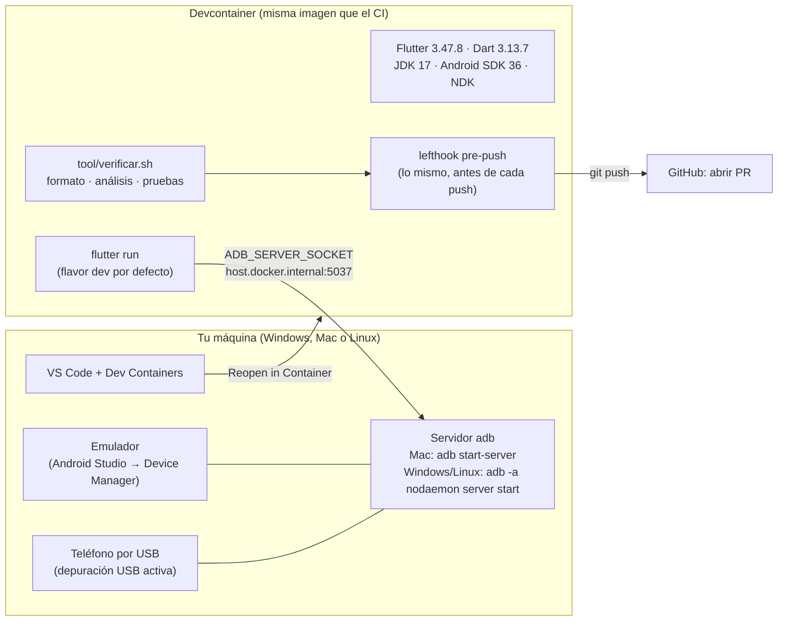
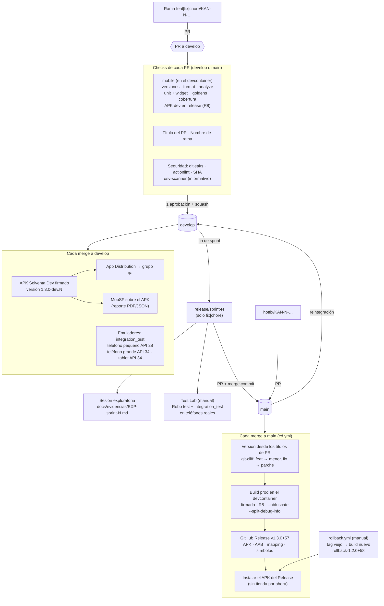
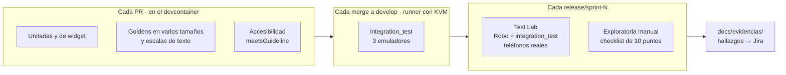

# Diagramas

Cómo fluye el código de tu máquina a los teléfonos, y cómo se corre el proyecto en local. El detalle de cada pieza está en [`ci-cd.md`](ci-cd.md), [`entorno-local.md`](entorno-local.md) y [`pruebas-exploratorias.md`](pruebas-exploratorias.md). GitHub dibuja los bloques Mermaid solo.

## 1. Correr el proyecto en local

Pasos de cada día:

1. VS Code → "Reopen in Container" (la primera vez descarga la imagen).
2. Abrir el emulador o conectar el teléfono, y en una terminal de tu máquina: en Mac `adb start-server`; en Windows y Linux `adb kill-server && adb -a nodaemon server start`.
3. En la terminal del contenedor: `flutter devices` y `flutter run`.
4. Antes del PR: `tool/verificar.sh` (el hook de pre-push lo corre solo).

## 2. CI/CD de punta a punta

Lo que todavía necesita cuentas (Firebase) ya está en los workflows y se salta solo mientras faltan los secretos ([`ci-cd.md`](ci-cd.md), "Pasos manuales").

## 3. Pruebas: qué corre y dónde

