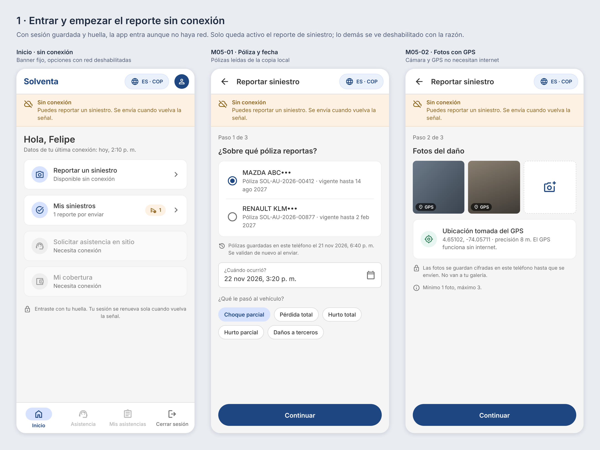
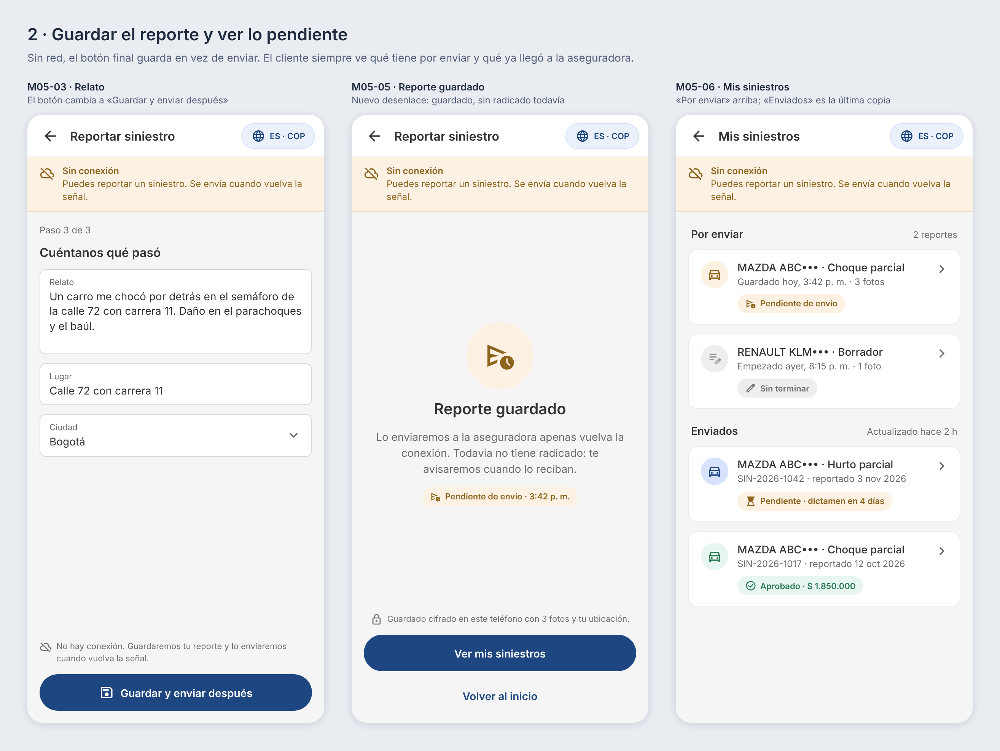
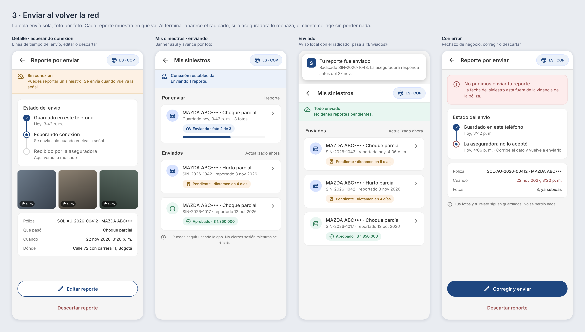
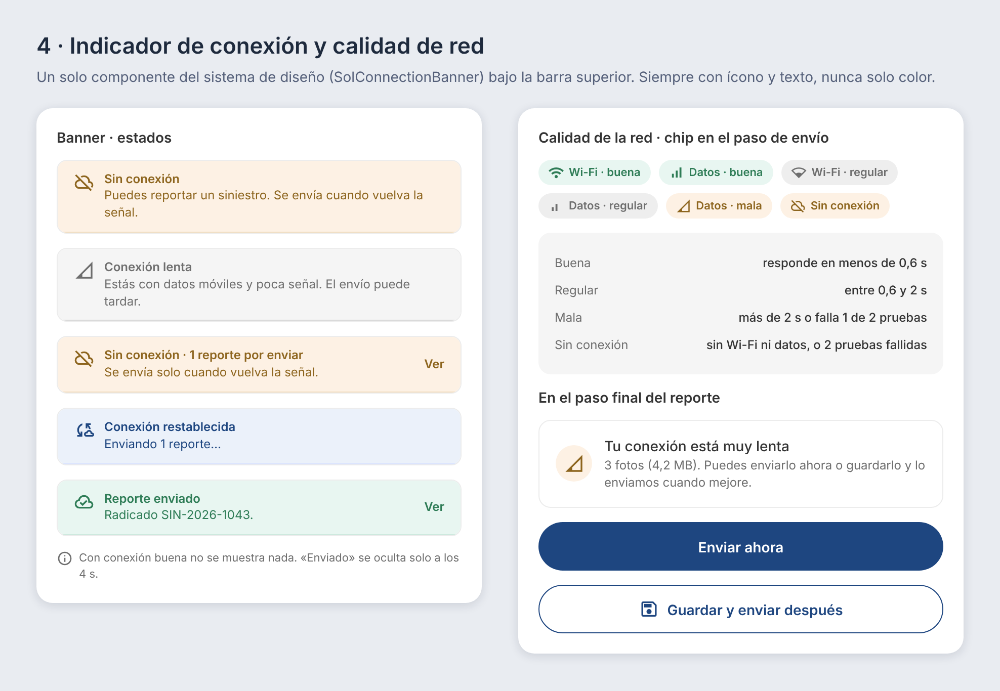
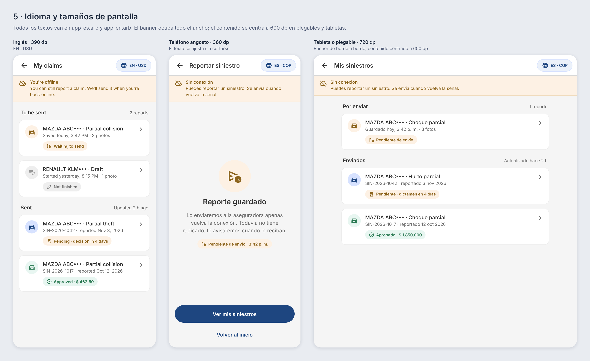
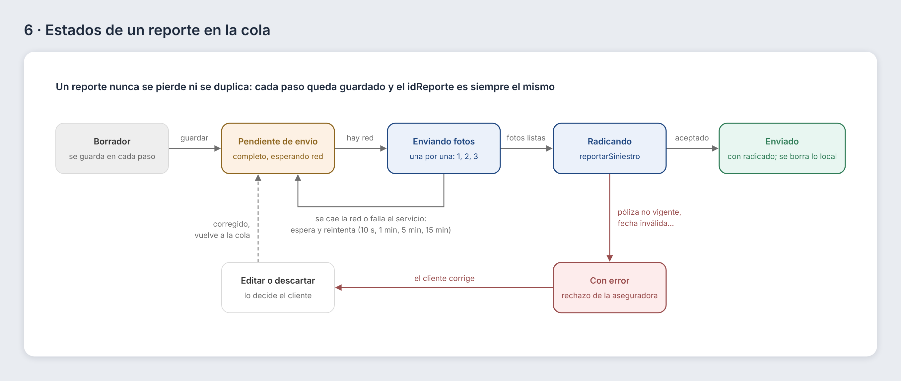
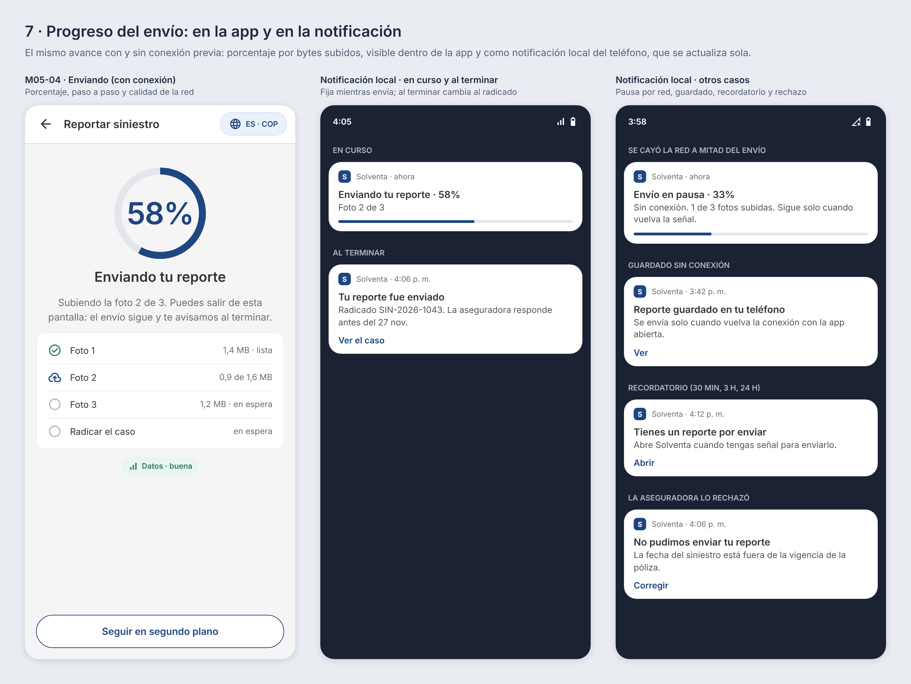
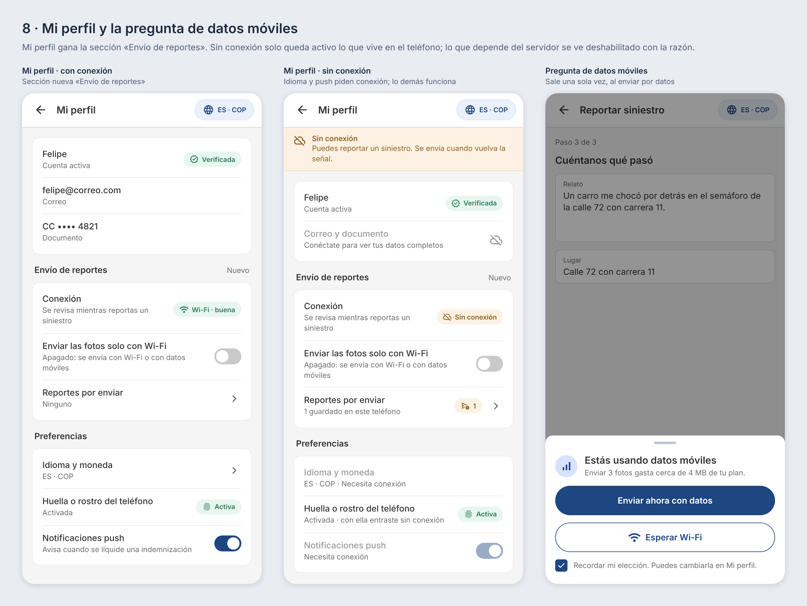
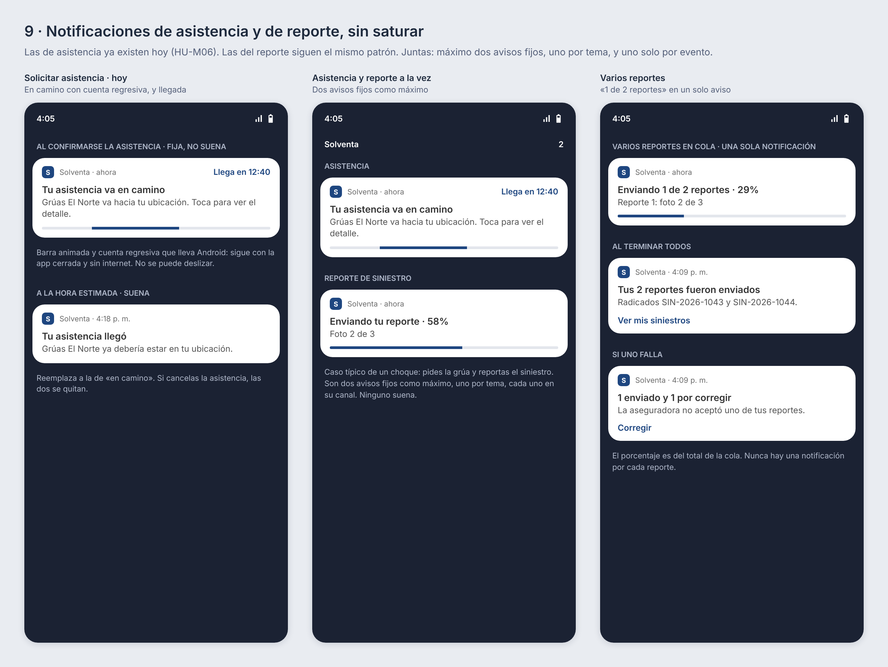

# Plan · Reporte de siniestro sin conexión (HU-M05, KAN-35)

Fecha: 2026-11-22 · Aprobado el plan completo (fases 0 a 5) e implementado el mismo día en ramas locales apiladas, sin PR. Qué quedó hecho, qué falta probar en teléfono y los huecos conocidos: `docs/hu-m05/README.md` del repo móvil.
Alcance acordado: el modo sin conexión es **solo para el reporte de siniestros**. Incluye lo mínimo para llegar a reportar sin red: entrar con la sesión guardada y la huella, y tener las pólizas en el teléfono.

Revisado sobre `develop` de GitHub al 2026-11-21 (móvil `06c740a`) y `develop` del backend. La copia de `develop` del Mac está en el 2026-11-10 y hay que actualizarla antes de crear ramas.

---

## 1. Resumen

Hoy, sin internet, la app no deja pasar del desbloqueo y un reporte a medio hacer vive solo en memoria. El plan agrega cinco piezas:

1. **Indicador de conexión y calidad de red** en el inicio y en todo el flujo del reporte.
2. **Almacén local cifrado** (SQLite) con las pólizas, el borrador del reporte, sus fotos y su ubicación.
3. **Cola de envío con estados** visibles: borrador, pendiente de envío, enviando, enviado y con error.
4. **Entrada sin red** con la huella y la sesión guardada, a un inicio donde solo funciona el reporte.
5. **Reconciliación** al volver la red: se envía solo, sin duplicar el caso ni volver a subir fotos, y el cliente ve el radicado.

El backend no cambia: `reportarSiniestro` ya es idempotente por `idReporte` y las fotos se suben a nombre de ese mismo id.

| Hoy | Con el plan |
|---|---|
| Abrir la app sin red: se queda en «Reintentar» | Entra con la huella a un inicio limitado |
| Empezar un reporte sin red: no se puede (faltan las pólizas) | Se puede, con las pólizas guardadas |
| Sin red al enviar: «Reintentar», todo en memoria | El reporte queda guardado y cifrado en el teléfono |
| Cerrar la app a mitad del reporte: se pierde todo | Queda como borrador y se puede continuar |
| Volver la red: nada pasa solo | La cola envía sola y avisa con el radicado |
| Indicador de conexión: no hay | Banner con estado y calidad de red |

---

## 2. Qué hay hoy (diagnóstico corto)

| Tema | Estado en `develop` | Archivo |
|---|---|---|
| Desbloqueo sin red | La huella descifra el refresh, pero la renovación falla y solo ofrece «Reintentar» | `lib/features/acceso/presentation/acceso_notifier.dart` (`AvisoAcceso.sinRed`) |
| JWT | Solo en memoria; el refresh dura 8 días | `lib/core/sesion/gestor_sesion.dart`, backend `auth/configuracion.py` |
| Pólizas de M05-01 | Se piden al BFF cada vez; sin copia local | `reporte_siniestro.graphql` (`PolizasParaReporte`) |
| Fotos | En memoria (`Uint8List`), máximo 3, hasta 10 MB cada una | `reporte_siniestro.dart` (`FotoSiniestro`, `ReglasReporte`) |
| GPS | `geolocator`, 10 s de espera y última posición conocida; funciona sin internet | `lib/core/ubicacion/ubicacion_service.dart` |
| Dirección escrita (sin GPS) | Se ubica con Places: necesita red | M05-02 |
| Ciudad | Catálogo dentro de la app; no necesita red | `lib/features/claims/domain/ciudades.dart` |
| Envío | Por cada foto: pedir URL firmada (vale 10 min), `PUT`, confirmar; luego `reportarSiniestro` | `reporte_siniestro_repository_impl.dart` |
| Reintento | Mismo `idReporte`; las fotos ya subidas se recuerdan solo en memoria | mapa `_subidas` |
| Mis siniestros | Siempre del BFF; sin copia local | `m05_06_mis_siniestros_page.dart` |
| Indicador de red | No existe; no está `connectivity_plus` | `pubspec.yaml` |
| Base local | No hay; `drift` está planeado en `docs/arquitectura.md` §8 | — |

Contra los criterios:

| Fuente | Pide | Estado |
|---|---|---|
| KAN-35, criterio 4 | Sin red, reintentar sin volver a subir fotos ni duplicar | Cumple (con la app abierta) |
| Estrategia de Pruebas v4, «Resiliencia Offline y Sensores (HU-M05/M06)» | El sincronizador local encola las evidencias y las envía cuando vuelve la señal | No existe |
| `docs/arquitectura.md` §8 | SQLite para evidencias pendientes y colas de sincronización | Planeado |

---

## 3. Cómo se ve (bocetos)

Hechos con los tokens del sistema de diseño (colores, Inter, radios, espaciados de `lib/core/design_system/tokens/`). La versión navegable está en `bocetos/bocetos.html`.

### 3.1 Entrar y empezar el reporte

### 3.2 Guardar y ver lo pendiente

### 3.3 Enviar al volver la red

### 3.4 Indicador de conexión y calidad

### 3.5 Idioma y tamaños

### 3.6 Estados de un reporte

### 3.7 Progreso del envío

### 3.8 Mi perfil y la pregunta de datos móviles

### 3.9 Notificaciones de asistencia y de reporte, sin saturar

Las de «Solicitar asistencia» ya existen (HU-M06) y no cambian; se muestran aquí para ver cómo conviven con las del reporte.

---

## 4. Diseño por pieza

### 4.1 Indicador de conexión y calidad de red

**Cómo se sabe el estado.** Un proveedor `estadoRedProvider` en `lib/core/red/` combina tres señales:

| Señal | Qué da | Cuándo |
|---|---|---|
| `connectivity_plus` | Wi-Fi, datos móviles o nada | Al cambiar la interfaz, al instante |
| Prueba al gateway (`GET {API_BASE_URL}/health`, ya publicado) | Si de verdad hay salida a internet y cuánto tarda | Al cambiar la interfaz, al volver la app al frente y cada 20 s **solo** dentro del reporte o con pendientes en cola |
| Resultado de las peticiones reales | Una falla `SinConexion` marca sin conexión de inmediato; un éxito marca conectado | Siempre |

Tener Wi-Fi no es tener internet, por eso la prueba al gateway decide. No se prueba fuera del reporte para no gastar batería ni datos.

**Calidad.**

| Calidad | Regla | Qué se muestra |
|---|---|---|
| Buena | La prueba responde en menos de 0,6 s | Nada |
| Regular | Entre 0,6 y 2 s | Nada en el banner; chip en el paso de envío |
| Mala | Más de 2 s, o falla 1 de las 2 últimas pruebas | Banner gris «Conexión lenta» |
| Sin conexión | Sin Wi-Fi ni datos, o 2 pruebas seguidas fallidas | Banner ámbar «Sin conexión» |

Los umbrales quedan en constantes para ajustarlos después de probar en teléfono real.

**Componente.** `SolConnectionBanner` nuevo en `lib/core/design_system/components/feedback/`, con las variantes del boceto 3.4. Usa `SolStatus` (ícono y texto, nunca solo color), se anuncia al lector de pantalla como región viva y respeta «quitar animaciones». Va bajo la barra superior en `SolAppShell` (inicio) y `SolFlowScaffold` (M05-01 a M05-07). Las demás pantallas siguen como hoy.

**Con mala señal en el paso final.** El cliente elige: «Enviar ahora» o «Guardar y enviar después» (boceto 3.4, derecha). Así no se queda mirando una barra con datos móviles débiles.

### 4.2 Almacén local cifrado

**Tecnología.** `drift` sobre SQLite cifrado con SQLCipher, como dice `docs/arquitectura.md` §8 («ningún dato personal va en SQLite sin cifrar»). El paquete exacto de cifrado se confirma en la fase 2 según la versión compatible con Flutter 3.47.8.

**Llave.** 32 bytes aleatorios creados en el primer uso, guardados en `flutter_secure_storage` (Keystore) con el prefijo del ambiente, igual que la sesión. El archivo de la base también lleva el prefijo (`dev.solventa.offline.db`).

**Tablas.**

| Tabla | Contenido | Se llena | Se borra |
|---|---|---|---|
| `cuenta_local` | Id de la cuenta, nombre para el saludo, si está verificada, fecha de la última conexión | En cada sesión con red | Al cerrar sesión |
| `polizas_cache` | Pólizas de auto reportables: id, número, vigencia, vehículo (placa enmascarada), fecha de guardado | Al entrar con red y cada vez que se abre M05-01 con red | Al cerrar sesión; se reemplaza en cada carga |
| `reportes` | `idReporte`, cuenta, póliza, qué pasó, fecha del hecho, relato, lugar, ciudad, ubicación, dirección escrita, estado, intentos, próximo intento, último error, radicado | En cada paso del reporte | 24 h después de enviado; al descartar; al cerrar sesión |
| `fotos_reporte` | Bytes de la foto, tipo, hora, ubicación, si viene del GPS o de la dirección, id del archivo ya subido | Al tomar la foto | Al quedar enviado el reporte |
| `siniestros_cache` | Última respuesta de `misSiniestros` y su hora | En cada carga con red | Al cerrar sesión |

Las fotos van como BLOB dentro de la misma base cifrada: un solo mecanismo de cifrado, guardado atómico con el reporte y sin archivos sueltos. Con máximo 3 fotos por reporte el tamaño es manejable; se leen una por una al enviar.

**Reglas de datos personales** (las del `CLAUDE.md` del repo): nada de esto va a logs, Sentry ni consola; las fotos nunca van a la galería; el respaldo de Android ya está apagado (`allowBackup="false"`).

**Límites.** Máximo 5 reportes sin enviar por cuenta. Antes de guardar una foto se revisa el espacio libre; si no alcanza, se avisa en vez de fallar en silencio. Un borrador sin tocar por 7 días se borra con aviso previo en la lista.

### 4.3 El reporte, paso a paso, sin red

| Pantalla | Con red (casi igual que hoy) | Sin red |
|---|---|---|
| Inicio | Igual, más el banner si la red es mala | Banner ámbar; solo «Reportar un siniestro» y «Mis siniestros» activos; lo demás deshabilitado con «Necesita conexión» |
| M05-01 Póliza y fecha | Pide las pólizas y actualiza la copia | Muestra la copia con «Pólizas guardadas el…». Si nunca se cargaron: «Conéctate una vez para descargar tus pólizas» |
| M05-02 Fotos | Igual | Igual: la cámara y el GPS no usan internet |
| M05-02 sin GPS | Dirección escrita y ubicada con Places | Solo vale el GPS: la app ofrece permitir la ubicación o abrir Ajustes. Si no fija, el borrador queda guardado y se termina al tener GPS o red |
| M05-03 Relato | Botón «Enviar reporte» | Botón «Guardar y enviar después» |
| M05-04 Enviando | Barra con «foto 2 de 3» | No aparece |
| M05-05 Resultado | Radicado, como hoy | «Reporte guardado», sin radicado, con la hora |
| M05-06 Mis siniestros | Lista del BFF, más «Por enviar» si hay | «Por enviar» arriba y la última copia con «Actualizado hace…» |
| M05-07 Detalle | Igual | Para un pendiente: línea de tiempo del envío, editar o descartar |

**Guardado automático (borrador).** Desde la primera foto, cada paso se escribe en la base. Si Android cierra la app, se acaba la batería o entra una llamada, al volver aparece «Continuar reporte» en Mis siniestros. Esto vale con y sin red.

**Validaciones que se hacen en el teléfono antes de guardar:** póliza vigente en la fecha del hecho, fecha no futura, mínimo 1 foto, relato de 10 a 1.000 caracteres, lugar y ciudad. Son las mismas del backend, para que un reporte guardado casi nunca sea rechazado después.

**Ubicación sin red (decidido: exigir GPS).** El GPS funciona sin internet pero puede tardar más en fijar: la espera sube de 10 a 30 s cuando no hay red, y si no fija se usa la última posición conocida mostrando su antigüedad. Sin permiso o con el GPS apagado, la app lleva a Ajustes (se puede activar sin internet). La dirección escrita no se ofrece sin conexión, porque ubicarla necesita red; si no hay forma de obtener el GPS, el reporte queda como borrador con el mensaje «Para reportar sin conexión necesitamos la ubicación de tu teléfono» y se termina al tener GPS o red.

### 4.4 Cola de envío y estados

| Estado | Significa | Qué ve el cliente | Qué puede hacer |
|---|---|---|---|
| Borrador | Reporte sin terminar | Chip gris «Sin terminar» | Continuar, descartar |
| Pendiente de envío | Completo, esperando red o turno | Chip ámbar con la hora en que se guardó | Editar, descartar, «Enviar ahora» si hay red |
| Enviando | Subiendo fotos o radicando | Chip azul «Enviando · foto 2 de 3» y barra | Nada (no se puede editar) |
| Enviado | La aseguradora devolvió el radicado | Pasa a «Enviados» como un caso normal | Ver el detalle |
| Con error | La aseguradora lo rechazó | Chip rojo con el motivo | Corregir y enviar, descartar |

**Cuándo arranca la cola.** Al pasar la red a conectado, al abrir la app o volver al frente, al renovarse la sesión y al tocar «Enviar ahora». Un reporte a la vez, del más antiguo al más nuevo.

**Pasos de un envío** (cada uno deja su resultado guardado antes del siguiente):

1. Comprobar que hay red y sesión abierta. Sin sesión, la cola espera.
2. Por cada foto sin id de archivo: pedir la URL firmada, subir, confirmar y **guardar el id**. La URL dura 10 minutos, así que se pide justo antes de cada subida, nunca por adelantado.
3. Llamar a `reportarSiniestro` con el mismo `idReporte`.
4. Con el radicado: marcar enviado, borrar las fotos del teléfono, refrescar Mis siniestros y mostrar el aviso.

**Fallas.**

| Falla | Qué hace la cola |
|---|---|
| Red caída, tiempo agotado, 502/503 | Vuelve a «Pendiente» y reintenta a los 10 s, 1 min, 5 min y luego cada 15 min. La espera se reinicia cuando cambia la red |
| URL de subida vencida | Pide otra y sube de nuevo esa foto |
| Sesión vencida (401 sin renovación) | Se detiene; banner «Inicia sesión para enviar tu reporte» |
| Rechazo de negocio (`ErrorSiniestro`) | «Con error» con el mensaje de la aseguradora; no se reintenta solo |
| La app se cierra a mitad | Al abrir, lo que estaba «Enviando» vuelve a «Pendiente» y sigue desde la foto que faltaba |

**Con la app cerrada no se envía.** Para renovar la sesión hace falta la huella: la llave privada del teléfono solo descifra el refresh 10 segundos después de autenticarse (decisión D3 de HU-M02). Un envío en segundo plano obligaría a guardar una credencial sin esa protección. En su lugar se programan recordatorios locales con `flutter_local_notifications` (ya está en el proyecto) a los 30 minutos, 3 horas y 24 horas: «Tienes un reporte por enviar. Abre Solventa cuando tengas señal». Se cancelan cuando el reporte se envía.

**Progreso del envío.** Vale igual para un envío normal con conexión y para uno que sale de la cola (boceto 3.7):

- El porcentaje se calcula por bytes subidos de todas las fotos (`onSendProgress` de Dio) y reserva el último 5 % para radicar el caso.
- Dentro de la app, M05-04 muestra el porcentaje, el paso (foto 1, 2, 3, radicar) y la calidad de la red. «Seguir en segundo plano» deja salir de la pantalla sin cortar el envío.
- Fuera de la pantalla, una notificación local fija con barra de progreso («Enviando tu reporte · 58 %»), que se actualiza sin sonar cada vez. Si se cae la red pasa a «Envío en pausa · 33 %» y retoma sola. Al terminar se reemplaza por «Tu reporte fue enviado» con el radicado.
- El envío sigue si el cliente cambia de app. Se construye en dos pasos: primero sin servicio (si Android cierra la app, queda en pausa y retoma al abrirla desde la foto que faltaba) y, una vez probado, se envuelve en un servicio en primer plano de Android (tipo `dataSync`) para que el sistema no la cierre mientras envía. El servicio usa la misma notificación de progreso, arranca solo al empezar un envío y se detiene al terminar o al quedar en pausa por red.

**Notificaciones locales: reglas.** Todas son locales (no dependen del servidor ni del interruptor «Notificaciones push» del perfil, que es del push de HU-M04). Van en un canal propio, «Reportes de siniestro», y el progreso en un canal silencioso aparte, igual que hizo HU-M06.

| Notificación | Cuándo sale | Suena |
|---|---|---|
| Enviando · 58 % (fija) | Hay un envío en curso y el cliente no está viendo la pantalla de envío | No |
| Envío en pausa | Se cae la red a mitad de un envío con la app en segundo plano | No |
| Tu reporte fue enviado | Llega el radicado y la app no está al frente | Sí |
| No pudimos enviar tu reporte | La aseguradora lo rechaza y la app no está al frente | Sí |
| Tu reporte espera Wi-Fi | Una vez por reporte, si la preferencia de solo Wi-Fi lo detiene | No |
| Tienes un reporte por enviar | Recordatorios a los 30 min, 3 h y 24 h de quedar pendiente | Sí |
| Inicia sesión para enviar tu reporte | Una vez, si la sesión vence con pendientes | Sí |

*Con la app al frente no se notifica:* lo mismo se muestra dentro de la app (banner, chip, pantalla de resultado). Así no hay aviso doble.

*Permiso de notificaciones (Android 13 o superior).*

- No se pide al abrir la app. Se pide la primera vez que un reporte queda guardado o empieza a enviarse, con una línea antes del diálogo: «Te avisaremos cuando tu reporte se envíe». Si ya se concedió por HU-M04 o HU-M06, no se vuelve a pedir.
- Si lo niega, no se insiste. Todo funciona igual y el estado se ve dentro de la app: banner, la insignia «1 por enviar» en el inicio y Mis siniestros. En el detalle del pendiente queda una nota discreta «Activa las notificaciones para avisarte cuando se envíe», con «Abrir Ajustes».
- También se revisa si el cliente apagó solo el canal «Reportes de siniestro» en Ajustes; se trata igual que un permiso negado.
- El servicio en primer plano funciona aunque el permiso esté negado; solo deja de verse su notificación.
- Los recordatorios se programan sin alarma exacta, así que no hace falta el permiso de alarmas exactas.

*Sesión y privacidad.*

- El texto nunca lleva datos personales: ni placa, ni dirección, ni nombre, ni el relato. Solo el estado y, al enviarse, el radicado.
- En la pantalla de bloqueo se muestra la versión pública («Solventa · Novedad en tu reporte») cuando el teléfono oculta contenido sensible.
- El dato que lleva la notificación es solo el `idReporte`. Al tocarla con la app bloqueada o recién abierta, primero pide la huella y después abre el reporte.
- Al cerrar sesión se cancelan todas las notificaciones y recordatorios de esa cuenta, aunque sus reportes se conserven. Sin sesión no se notifica nada, porque el teléfono puede estar en otras manos.
- Con otra cuenta en el teléfono no se notifica nada de la primera.
- Si la sesión vence, sale un único aviso para iniciar sesión y se detienen los recordatorios.

*Con o sin conexión.*

- Ningún aviso depende de tener red para mostrarse. Los recordatorios los dispara Android aunque la app esté cerrada y sin internet; por eso su texto no promete nada: «Abre Solventa cuando tengas señal».
- Que vuelva la conexión no genera notificación por sí sola. Si la app sigue viva, la cola arranca y aparece la de progreso.
- Los recordatorios se cancelan apenas el reporte se envía, se descarta o pasa a «Con error».

*Para no saturar.*

- Una sola notificación por reporte: la nueva reemplaza a la anterior (mismo identificador de notificación).
- Con varios reportes en la cola, una sola notificación de progreso para todos: «Enviando 1 de 2 reportes · 29 %». El porcentaje es el de toda la cola (bytes de todas las fotos de todos los reportes). Al terminar queda un único resultado: «Tus 2 reportes fueron enviados» o «1 enviado y 1 por corregir». Al tocarla abre Mis siniestros.
- Con varios reportes pendientes, un solo recordatorio agrupado: «Tienes 2 reportes por enviar».
- Máximo 3 recordatorios por reporte (30 min, 3 h, 24 h) y después ninguno más. Como el tope es de 5 pendientes y se agrupan, el peor caso sigue siendo 3 recordatorios en total.
- Horario de silencio: si un recordatorio cae entre las 10 p. m. y las 7 a. m., se mueve a las 7 a. m. Se usa la hora y la zona horaria del teléfono (la que tiene configurada Android), no la del servidor ni una zona fija de Colombia. La app calcula la hora local al programarlo y lo agenda como hace HU-M06; no necesita paquetes nuevos. Si el cliente viaja o cambia la zona, se recalcula la próxima vez que abre la app. El silencio aplica solo a los recordatorios: el progreso y el resultado de un envío salen a cualquier hora porque el cliente lo acaba de pedir, y el progreso no suena.

*Convivencia con «Solicitar asistencia» (HU-M06, boceto 3.9).* Las notificaciones de asistencia ya existen y no cambian:

| Notificación de asistencia | Cuándo sale | Suena |
|---|---|---|
| Tu asistencia va en camino (fija, con barra y cuenta regresiva) | Al confirmarse la solicitud, mientras el prestador va hacia el cliente | No |
| Tu asistencia llegó | A la hora estimada de llegada; reemplaza a la anterior | Sí |

- Cada tema tiene su propio canal y su propio identificador, así que una nunca pisa a la otra y el cliente puede silenciar un tema sin perder el otro desde Ajustes de Android.
- Tope a la vez: como máximo dos notificaciones fijas, una de asistencia y una de reportes. Dentro de cada tema siempre hay una sola, que se va actualizando.
- Las fijas (progreso, en camino) no suenan al actualizarse. Solo suenan los resultados: llegó la asistencia, se envió el reporte, hay algo por corregir.
- Las dos se agrupan bajo «Solventa» en la bandeja, como hace Android con las de una misma app.
- Al cambiar el idioma se reprograman con el texto nuevo, como en HU-M06.

**Permisos.** No se pide permiso de almacenamiento: la base vive en la carpeta privada de la app. Siguen siendo los de hoy: cámara, ubicación y notificaciones.

**Datos móviles.** La preferencia «Enviar las fotos solo con Wi-Fi» funciona así:

- **Se pregunta una vez.** La primera vez que un reporte va a salir por datos móviles, una hoja inferior pregunta: «Estás usando datos móviles. Enviar 3 fotos gasta cerca de 4 MB», con «Enviar ahora con datos» y «Esperar Wi-Fi», y la casilla «Recordar mi elección».
- **Dónde queda.** En Mi perfil, sección «Envío de reportes», como interruptor. Apagado por defecto. También se puede cambiar desde el detalle de un reporte pendiente. Se guarda en `shared_preferences` (no es un dato personal).
- **Con la preferencia encendida y solo datos móviles.** El reporte queda con el chip «Esperando Wi-Fi» y siempre ofrece «Enviar ahora con datos» para ese reporte, sin cambiar la preferencia.
- **Avisos, sin saturar.** No se notifica cada vez que cambia la red: eso lo muestra el banner dentro de la app. Las notificaciones del teléfono salen solo cuando cambia algo de un reporte: guardado, esperando Wi-Fi (una vez por reporte, con la acción «Enviar ahora con datos»), enviado, rechazado y los recordatorios.

### 4.5 Entrar sin red

Hoy `GestorSesion.desbloquear()` ya descifra el refresh con la huella y solo después intenta renovar. Ese descifrado es la prueba local de identidad: la llave no se abre sin huella o PIN del teléfono. El cambio es qué se hace cuando la renovación falla por red:

| Situación | Hoy | Con el plan |
|---|---|---|
| Huella correcta, sin red, sesión guardada vigente | Aviso «No hay conexión» y «Reintentar» | Entra al inicio en modo sin conexión, sin JWT |
| Vuelve la red | El cliente toca «Reintentar» | La sesión se renueva sola con el refresh en memoria y arranca la cola |
| El refresh venció (más de 8 días sin conexión) | Va al login | Igual: sin red no se puede entrar. Los reportes guardados siguen ahí y se envían al iniciar sesión con la misma cuenta |
| No hay sesión guardada (primera vez, o cerró sesión) | Login | Igual: sin red no se puede entrar |
| Teléfono sin bloqueo de pantalla | El refresh no se guarda | Igual: sin modo sin conexión |

**Sin huella.** Con PIN, patrón o contraseña del teléfono se entra igual: el diálogo de Android ya ofrece el bloqueo del teléfono desde el primer intento. Sin ningún bloqueo de pantalla no hay sesión guardada y se informa en dos momentos: con red, al iniciar sesión («Activa el bloqueo de pantalla de tu teléfono para poder reportar un siniestro sin conexión», con botón a Ajustes); y sin red, en la pantalla de ingreso («No hay conexión. Para entrar sin internet necesitas haber iniciado sesión antes en este teléfono con el bloqueo de pantalla activo»). Con la sesión guardada vencida: «Tu sesión guardada venció. Conéctate para iniciar sesión».

En modo sin conexión no hay ninguna llamada autenticada: la app solo lee y escribe en el almacén local. Se agrega una fase `FaseAcceso.sinConexion` al `AccesoNotifier` y el `router` muestra el inicio con lo cacheado en `cuenta_local`.

Solo pueden reportar sin red las cuentas verificadas, igual que hoy; ese dato sale de `cuenta_local`.

**Mi perfil sin conexión** (boceto 3.8). Gana la sección «Envío de reportes»: estado de la conexión, el interruptor de solo Wi-Fi y el acceso a los reportes por enviar. Sin conexión se ve el nombre y el estado de la cuenta, que están en `cuenta_local`; el correo y el documento no se guardan en el teléfono y muestran «Conéctate para ver tus datos completos». Idioma y moneda y el interruptor de notificaciones push se guardan en el servidor: sin conexión se ven en gris, no se pueden cambiar y dicen «Necesita conexión». La huella se muestra «Activada» (con ella se entró) y sigue funcionando. Las notificaciones locales del reporte no dependen de ese interruptor de push. La pantalla de inicio de sesión no cambia, salvo los mensajes de la sección anterior.

### 4.6 Reconciliación y conflictos

| Caso | Qué pasa |
|---|---|
| El envío llegó pero la respuesta se perdió | El reintento usa el mismo `idReporte` y el backend devuelve el mismo caso. No hay duplicado |
| Se subieron 2 de 3 fotos y se cayó la red | Al volver sube solo la tercera; los ids de las otras dos están guardados |
| La póliza venció o se canceló mientras estaba pendiente | El backend lo rechaza; pasa a «Con error» con el motivo |
| El reloj del teléfono está adelantado | El backend responde «la fecha no puede ser posterior a hoy»; «Con error» para corregir la fecha |
| El cliente edita un pendiente | Permitido solo en «Pendiente» y «Con error». Si un intento de radicar quedó sin respuesta, la edición se bloquea hasta saber si el caso ya existe |
| El cliente hace el mismo reporte dos veces | Al empezar uno nuevo con otro por enviar se avisa: «Ya tienes 1 reporte por enviar» |
| El caso aparece en el BFF y en la cola a la vez | Se cruza por `idReporte`: gana el del BFF y se borra el local |
| Otra cuenta inicia sesión en el mismo teléfono | No ve ni envía los pendientes de la primera, que siguen cifrados a nombre de su cuenta. Se borran a los 30 días sin que esa cuenta vuelva |
| Cierre de sesión con pendientes | Nunca se borran sin que el cliente lo pida. Ver «Sesión y reportes guardados» más abajo |
| Se desinstala la app o se borran sus datos | Los pendientes se pierden. Se dice en la pantalla «Reporte guardado» |
| Estados de los casos ya enviados | La copia local es solo de lectura y se reemplaza entera en cada carga; siempre muestra «Actualizado hace…» |

**Una regla de negocio para tener presente.** El plazo del dictamen cuenta desde que la aseguradora recibe el reporte (`notificado_en` es la hora del servidor), no desde que se guardó en el teléfono. La fecha del hecho sí se conserva. La pantalla «Reporte guardado» lo dice: «Todavía no tiene radicado».

**Sesión y reportes guardados.**

| Situación | Qué pasa con la sesión | Qué pasa con lo guardado |
|---|---|---|
| App en segundo plano más de 15 minutos | Se bloquea y pide la huella al volver (igual que hoy). Sin red, la huella vuelve a abrir el modo sin conexión | Nada |
| Sin conexión, por horas o días | No se cierra sola. La sesión guardada sirve hasta 8 días desde la última conexión | Nada |
| Con conexión | Se renueva sola cada hora; los 8 días se cuentan de nuevo en cada renovación | Nada |
| Más de 8 días sin conectarse, o la sesión se revoca | Vence: pide correo y clave, y para eso hace falta internet | Se conserva cifrado; se envía al entrar con la misma cuenta |
| El cliente toca «Cerrar sesión» con reportes sin enviar | Diálogo: «Tienes 1 reporte sin enviar. Quedará guardado en este teléfono y se enviará cuando vuelvas a iniciar sesión con esta cuenta». Con red ofrece primero «Enviar ahora» | Se conserva cifrado a nombre de la cuenta, salvo que marque «Borrar también los reportes guardados» |
| Pasan 30 días sin que la cuenta vuelva a entrar | — | Se borra |

Lo guardado solo lo puede leer la app, con la llave del Keystore, y solo lo muestra a la cuenta que lo creó.

**Garantías de consistencia.** Lo que asegura que nada quede a medias:

1. **Guardar antes de avanzar.** Cada paso (foto tomada, foto subida, caso radicado) se escribe en la base en una transacción antes de empezar el siguiente. Si la app muere, al abrir se sabe exactamente en qué iba.
2. **La aseguradora nunca ve un reporte a medias.** El caso solo se crea en el último paso (`reportarSiniestro`), cuando todas las fotos ya están arriba. Una foto subida sin caso es un archivo suelto que la mesa de siniestros no ve.
3. **Mismo `idReporte` siempre.** Reenviar no crea otro caso: el backend devuelve el que ya existe.
4. **Reanudar, no reiniciar.** Tras un corte se sube solo lo que faltaba.
5. **Un solo envío a la vez**, con candado, para que dos disparos (vuelve la red y se abre la app) no se pisen.
6. **Solo dos finales posibles:** enviado con radicado, o con error y el motivo. En ambos el cliente recibe aviso. Mientras tanto siempre se ve como «por enviar».
7. **Nunca se borra solo** un reporte completo. Lo local se borra únicamente después de que el backend confirma el radicado.

### 4.7 Idioma, tamaños y accesibilidad

- Todos los textos nuevos (cerca de 45) van en `app_es.arb` y `app_en.arb`. Fechas, horas y montos con `SolFormat`, según el idioma y la moneda elegidos.
- Teléfonos desde 360 dp y contenido centrado a 600 dp en plegables y tabletas, con `SolAdaptiveBody`. El banner va de borde a borde.
- Cada estado lleva ícono y texto. El banner se anuncia al lector de pantalla cuando cambia. Áreas táctiles de 48 dp.
- Goldens de CI en 360, 390 y 600 dp, en ES y EN, para el banner y las pantallas nuevas.

---

## 5. Cambios por archivo

| Capa | Nuevo | Se modifica |
|---|---|---|
| `lib/core/red/` | `estado_red.dart`, `estado_red_notifier.dart`, `sonda_red.dart` (la prueba al gateway) | — |
| `lib/core/almacen/` | `base_local.dart` (drift), tablas, `llave_base.dart`, migración 1 | — |
| `lib/core/design_system/` | `sol_connection_banner.dart`, entrada en la galería | `sol_app_shell.dart`, `sol_flow_scaffold.dart` (hueco para el banner), `sol_action_tile.dart` (estado deshabilitado con razón) |
| `lib/core/sesion/` | — | `gestor_sesion.dart` (renovar sola al volver la red) |
| `lib/features/acceso/` | — | `acceso_notifier.dart` (fase `sinConexion`), `m02_01_desbloqueo_page.dart` |
| `lib/features/claims/data/` | `reporte_local_datasource.dart`, `polizas_cache_datasource.dart`, `cola_reportes.dart` | `reporte_siniestro_repository_impl.dart` (ids de fotos en la base en vez del mapa en memoria) |
| `lib/features/claims/domain/` | `reporte_pendiente.dart` (estados) | `reporte_siniestro.dart` |
| `lib/features/claims/presentation/` | `m05_07b_reporte_pendiente_page.dart`, `cola_notifier.dart` | `reporte_notifier.dart` (guardado por paso), M05-01, M05-02, M05-03, M05-05, M05-06 |
| `lib/features/home/` | — | `home_page.dart` (modo sin conexión) |
| `lib/app/` | — | `router.dart`, `solventa_app.dart` (arranque de la cola) |
| `lib/core/l10n/arb/` | — | `app_es.arb`, `app_en.arb` |
| `pubspec.yaml` | `connectivity_plus`, `drift`, SQLite cifrado, `drift_dev` | — |
| Backend | Nada | Nada |

---

## 6. Pruebas

| Tipo | Qué cubre |
|---|---|
| Unitarias de la cola | Orden; reanudar tras subida parcial; URL vencida; respuesta perdida y mismo `idReporte`; rechazo de negocio; esperas del reintento con reloj falso; reinicio de la app a mitad de envío |
| Unitarias del almacén | Base en memoria; migración; borrado al enviar y al cerrar sesión; límite de 5 pendientes; que no abre sin la llave |
| Unitarias de la red | Wi-Fi sin internet; umbrales de calidad; que la sonda no corre fuera del reporte |
| Unitarias del acceso | Huella correcta sin red entra en modo sin conexión; refresh vencido no entra; renovación sola al volver la red |
| Widget y goldens | Banner en sus 5 variantes, inicio sin conexión, M05-05 guardado, M05-06 con pendientes, detalle con error; 360, 390 y 600 dp; ES y EN |
| `integration_test/` (emuladores del CI) | Recorrido completo con una red falsa que se apaga y se prende: reportar sin red, ver el pendiente, volver la red, ver el radicado. Segundo recorrido: cerrar la app a mitad y continuar el borrador |
| Sesión exploratoria en teléfono real | Modo avión en cada paso; datos débiles; apagar el teléfono con un pendiente; 3 fotos grandes; sin GPS. Evidencia en `docs/evidencias/` (el charter ya está en `docs/pruebas-exploratorias.md`) |
| Backend | Sin cambios. El caso 2 de Newman `hu-m05` ya prueba el reenvío con el mismo `idReporte` |

Todo corre dentro del devcontainer con `tool/verificar.sh`; los goldens se regeneran con `tool/goldens.sh`.

---

## 7. Fases y ramas

Ramas locales en el Mac, apiladas, sin PR, desde `develop` actualizado. No se tocan las ramas de navegación (KAN-259) ni de idioma y moneda (KAN-209). Commits con un único autor (felipe), sin atribuciones.

| Fase | Rama | Entrega | Tamaño | Se puede probar |
|---|---|---|---|---|
| 0 | — | Actualizar `develop` del Mac, confirmar el paquete de cifrado y que `tool/verificar.sh` pasa | Pequeña | — |
| 1 | `feat/KAN-35-sin-conexion-1-indicador` | Estado de red, banner, calidad | Pequeña | Modo avión: aparece el banner |
| 2 | `feat/KAN-35-sin-conexion-2-almacen` | Base cifrada, pólizas guardadas, borrador que sobrevive al cierre | Mediana | Cerrar la app a mitad del reporte y continuar |
| 3 | `feat/KAN-35-sin-conexion-3-cola` | Cola, estados, «Reporte guardado», «Por enviar», detalle, recordatorios | Grande | Se cae la red al enviar: queda guardado y se envía solo al volver |
| 3b | `feat/KAN-35-sin-conexion-3b-servicio` | Servicio en primer plano durante el envío (permisos `FOREGROUND_SERVICE` y `FOREGROUND_SERVICE_DATA_SYNC`), sobre la cola ya probada | Pequeña | Salir de la app a mitad del envío: termina sin abrirla |
| 4 | `feat/KAN-35-sin-conexion-4-acceso` | Entrar sin red con la huella, inicio limitado | Mediana | Abrir la app en modo avión y reportar de principio a fin |
| 5 | `feat/KAN-35-sin-conexion-5-pruebas` | Prueba de integración, goldens, `docs/arquitectura.md` §8, `PROJECT_STATUS.md`, evidencia | Mediana | — |

Las fases 1 a 3 ya dejan resuelto «se cae la red mientras reporto». La fase 4 agrega «abro la app sin red». Cada fase queda en verde antes de pasar a la siguiente.

El sprint 3 cierra el 23 de noviembre de 2026 a las 11:59 p. m. (hora de Bogotá).

---

## 8. Riesgos

| Riesgo | Cómo se atiende |
|---|---|
| El paquete de SQLite cifrado no compila con Flutter 3.47.8 o con R8 | Se prueba en la fase 0, con build de release. Alternativa: cifrar con AES-GCM los archivos y guardar solo metadatos |
| El GPS tarda en fijar sin red | Espera de 30 s y última posición con su antigüedad. Si no fija, el borrador queda guardado para terminarlo después |
| El cliente cree que ya reportó y solo está guardado | Pantalla distinta («Reporte guardado», ámbar, sin radicado), chip en el inicio y recordatorios |
| La cola envía dos veces por una carrera | Un solo trabajador con candado, y el `idReporte` protege del lado del backend |
| Fotos de un siniestro guardadas en un teléfono perdido | Base cifrada con llave en el Keystore; solo se abre tras la huella |
| Cambios en `AccesoNotifier` rompen HU-M02 | Fase aparte (4), con sus pruebas y los goldens de M02-01 existentes |

---

## 8.1 Revisión final: huecos encontrados y cómo se cubren

Revisión del 2026-11-22 sobre el plan completo. Todo lo de esta tabla entra en la fase indicada.

**Manejo de errores**

| Caso que faltaba | Cómo se cubre | Fase |
|---|---|---|
| Wi-Fi con portal cautivo (hotel, centro comercial): hay «internet» pero no sale | La prueba al gateway valida el contenido de la respuesta de `/health`, no solo que conteste | 1 |
| La base local no abre (llave perdida o archivo dañado) | Se crea una base vacía y se avisa una sola vez: «No pudimos recuperar lo guardado en este teléfono». Se registra en Sentry sin datos personales | 2 |
| Teléfono sin espacio al guardar una foto | Aviso antes de tomarla: «No hay espacio en tu teléfono para guardar la foto» | 2 |
| Foto de más de 10 MB | Hoy se descarta en silencio; pasa a mostrar un mensaje y se reduce la calidad de captura para que no ocurra | 2 |
| La subida terminó pero la confirmación falló | Esa foto se vuelve a subir; las demás no | 3 |
| Falla técnica que se repite sin fin (error del servicio, respuesta inesperada) | Tras 8 intentos el reporte queda «Necesita atención», deja de reintentar solo y ofrece «Enviar ahora»; nunca se borra | 3 |
| La sesión vence justo durante el envío | La cola se detiene sin perder lo subido y sigue al volver a entrar | 3 |
| Detalle de un caso ya enviado (M05-07) abierto sin red | El detalle no se guarda en el teléfono: muestra el resumen de la lista y «Conéctate para ver el detalle completo» | 3 |
| Tocar una notificación con la app bloqueada | Primero pide la huella y después abre el reporte | 3 |
| El cliente niega el permiso de notificaciones | Todo funciona igual; el estado se ve dentro de la app | 3 |
| Cambio de idioma con reportes pendientes | Los textos se arman al mostrarse; las notificaciones programadas se reprograman traducidas, igual que en HU-M06 | 3 |
| Actualización de la app con reportes pendientes | Migraciones de la base versionadas y probadas; lo pendiente sobrevive a la actualización | 2 |
| Ahorro de batería o reposo del teléfono | Los temporizadores se pausan; la cola revisa siempre al volver la app al frente | 3 |

**Responsive y adaptativo**

| Punto | Estado |
|---|---|
| 360, 390 y 600 dp o más | Cubierto: `SolAdaptiveBody`, goldens en los tres anchos |
| Letra grande del sistema (hasta 200 %) | Faltaba: el banner y los chips deben crecer en alto y pasar a dos líneas sin cortar texto. Prueba de widget con escala 2,0 |
| Teclado abierto en el relato | El banner se compacta a una línea para no robar espacio |
| Tema oscuro | La app solo tiene tema claro hoy; no se agrega |
| Lector de pantalla | El banner y el porcentaje se anuncian; cada chip lleva texto |

**Sistema de diseño**

| Punto | Estado |
|---|---|
| Colores | Solo los roles del tema (`context.colors`, `context.solColors`): advertencia para sin conexión, primario para enviando, éxito para enviado, error para rechazo. Ningún color nuevo |
| Tipografía | Inter con los estilos de `SolTypography`; sin tamaños sueltos |
| Espaciado y radios | `SolSpacing` y `SolRadius` |
| Íconos | Faltaba: los de nube y señal no están en `SolIcons`. Se agregan ahí (sin conexión, sincronizando, enviado, pendiente de envío, Wi-Fi y datos por nivel) y las pantallas los usan desde `SolIcons`, nunca directo |
| Componentes | Banner y chips nuevos van al sistema de diseño y a la galería (`sol_gallery_page.dart`), no dentro de la feature |

**Para la demo**

En el ambiente `mock` se agrega un interruptor oculto «Simular sin conexión» (con el `SolDemoTrigger` que ya existe), para mostrar el recorrido completo sin poner el teléfono en modo avión.

---

## 9. Decisiones

Tomadas:

- El modo sin conexión es solo para el reporte de siniestros.
- El interruptor «Enviar las fotos solo con Wi-Fi» se queda, apagado por defecto, con pregunta la primera vez y ajuste en Mi perfil.
- Jira (KAN-35 y sus criterios) se corrige después de implementar; propuesta en la sección 10.
- Cierre de sesión con pendientes: se conservan cifrados y se envían al volver a entrar con la misma cuenta, con opción de borrarlos.
- Sin GPS y sin red: se exige el GPS; la dirección escrita no se ofrece sin conexión.
- Envío al salir de la app: primero se construye y prueba sin servicio; después se agrega el servicio en primer plano de Android, que **sí queda en la entrega** (fase 3b).
- Límites: máximo 5 reportes sin enviar, borradores sin tocar se borran a los 7 días, lo de una cuenta que no vuelve se borra a los 30 días.
- Umbrales de calidad de red (0,6 s y 2 s): se ajustan después de probar en teléfono real.

- **Arranque y alcance (2026-11-22).** Plan completo, fases 0 a 5, solo en local: ramas en el Mac, sin push ni PR.

Pendiente: nada por decidir. Falta la prueba en teléfono (`docs/hu-m05/pruebas-sin-conexion.md`).

---

## 10. Criterios de aceptación propuestos para KAN-35

Para agregar a los 7 que ya tiene la historia, cuando se actualice en Jira:

- Con sesión guardada y sin internet, el cliente entra con su huella o el bloqueo del teléfono y puede reportar un siniestro sobre sus pólizas de auto guardadas.
- Sin internet, el reporte queda guardado en el teléfono con sus fotos, la ubicación del GPS y el relato, cifrado, y sobrevive al cierre de la app.
- La app muestra si no hay conexión o si es lenta, con ícono y texto, en el inicio y en todo el reporte.
- En «Mis siniestros» el cliente distingue lo que está por enviar (sin terminar, pendiente de envío, enviando, con error) de lo que ya recibió la aseguradora.
- Al volver la conexión con la app abierta, el reporte se envía solo, sin volver a subir las fotos ya subidas y sin duplicar el caso, y el cliente recibe el radicado.
- Si la aseguradora rechaza un reporte guardado, el cliente ve el motivo y puede corregirlo o descartarlo sin perder las fotos ni el relato.
- Al cerrar sesión con reportes sin enviar, la app avisa cuántos hay y los conserva cifrados en el teléfono para enviarlos cuando el cliente vuelva a entrar con la misma cuenta; solo se borran si el cliente lo pide en ese aviso.
